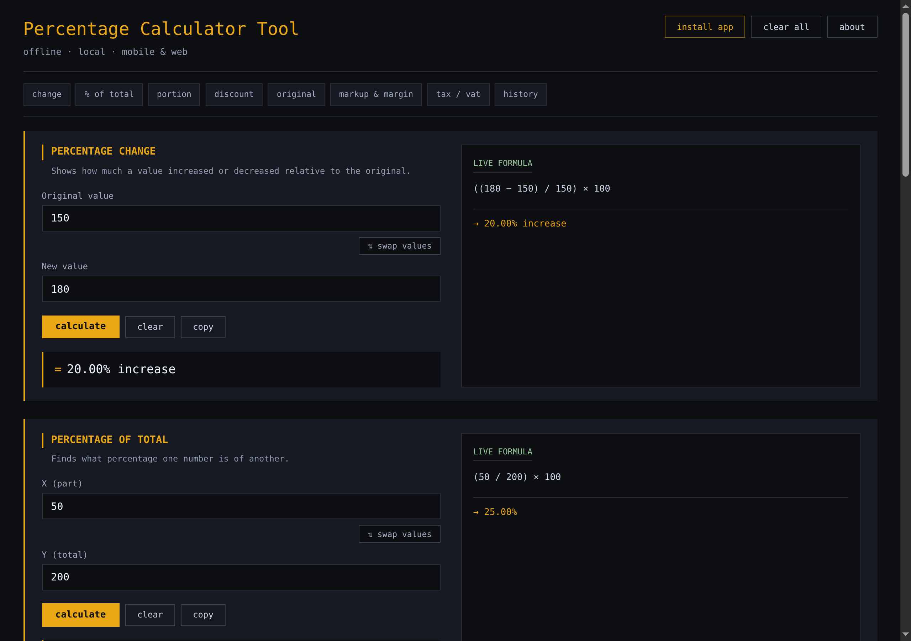
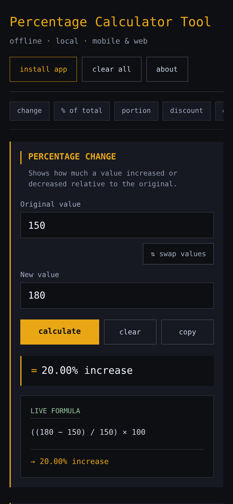

<p align="center">
  
</p>

<h1 align="center">Percentage Calculator Tool</h1>

<p align="center">
  <strong>Offline percentage, pricing, and reverse tax/VAT calculator for Windows (Tauri v2 + Rust) and iPhone / Android PWA</strong>
</p>

<p align="center">
  <a href="https://ciphervaults.github.io/Percentage-Calculator-Tool/"><strong>Open Live Mobile &amp; Web App</strong></a>
  &nbsp;·&nbsp;
  <a href="https://github.com/CipherVaults/Percentage-Calculator-Tool/releases/latest"><strong>Download v2.2.0 Releases</strong></a>
  &nbsp;·&nbsp;
  <a href="#security--privacy-hardening-v211"><strong>Security Hardening</strong></a>
  &nbsp;·&nbsp;
  <a href="Documentation/1-%20PROJECT_CONTEXT.md"><strong>Documentation</strong></a>
</p>

> **Official Mobile & Web App (iPhone, iPad, Android & Browser):** **[https://ciphervaults.github.io/Percentage-Calculator-Tool/](https://ciphervaults.github.io/Percentage-Calculator-Tool/)**
>
> Always verify you are opening `https://ciphervaults.github.io/Percentage-Calculator-Tool/` directly before installing to your Home Screen. For Windows desktop builds, offline `.exe` / `.msi` installers, standalone HTML, and `SHA256SUMS.txt`, see [**GitHub Releases**](https://github.com/CipherVaults/Percentage-Calculator-Tool/releases/latest).

This project started as a single-file HTML percentage utility, became a structured Electron desktop app in v1.1.0, was rebuilt on **Tauri v2 + Rust** in **v2.0.0**, expanded in **v2.1.0** with input swapping, Markup & Profit Margin, Reverse Tax/VAT, persistent local history, a dark-terminal About modal, and a Mobile/Web PWA, was security-hardened in **v2.1.1**, and was refined in **v2.2.0** with formatted paste support, history filtering and single-item deletion, and a Settings-controlled GitHub Releases update checker.

> Looking for the last Electron version? Check out the [`v1.1.0-electron`](https://github.com/CipherVaults/Percentage-Calculator-Tool/tree/v1.1.0-electron) tag.

---

## Visual Preview

| Desktop & Wide Browser | iPhone & Android PWA |
| :---: | :---: |
|  |  |

---

## Credits

Made by **Mohamed Sayed · Ahmed Emara · DeepSeek · ChatGPT · Antigravity**.

- **Creators:** Mohamed Sayed · Ahmed Emara
- **AI Collaboration:** DeepSeek & ChatGPT (original HTML utility), Codex (v1.1 Electron packaging), and Antigravity (v2.0 Tauri + Rust rebuild, v2.1 feature expansion & mobile PWA, v2.1.1 security hardening, v2.2.0 calculator/history polish & update checker).

The repository remains intentionally transparent about that collaboration because the development record is part of the value of the project.

---

## What This App Is

Percentage Calculator Tool is a practical offline utility for common percentage, pricing, and tax calculations on both Windows desktop and mobile devices.

It is designed for quick local use rather than account-based or cloud-connected workflows:

- no login or user accounts
- no telemetry, cookies, or tracking
- zero runtime network calls during calculations (the Mobile & Web PWA works fully offline once cached; optional GitHub Releases update checks can be toggled in Settings)
- local-only calculation history & settings (desktop stores up to 500 entries in `%APPDATA%\com.percentagecalculator.tool\history.json` and update preferences in `settings.json`; Mobile & Web stores up to 500 entries and preferences on-device in `localStorage`, clearable anytime)

The app is intentionally small. Its value is speed, clarity, and an inspectable, hardened codebase.

---

## Mobile & Web Edition (iPhone & Android)

A zero-dependency single-file HTML + offline PWA edition of **v2.2.0** lives in `mobile/` and is deployed from `main` to GitHub Pages:

- **Official Web App URL:** **[https://ciphervaults.github.io/Percentage-Calculator-Tool/](https://ciphervaults.github.io/Percentage-Calculator-Tool/)**
  - **iPhone / iPad (Safari):** Open the link in **Safari** → tap **Share (`↑`)** → **Add to Home Screen** → **Add**.
  - **Android (Chrome / Edge):** Open the link → tap **`⋮`** (or **install app**) → **Install app** (or **Add to Home screen**).
  - **Offline Ready:** The scoped Service Worker (`mobile/sw.js`) caches the full app and icons locally after first open, and local history (up to 500 entries) stays on your device in `localStorage`.
- **Single-File HTML (`mobile/index.html`):** Works standalone when opened directly in any browser without external dependencies (`install app` automatically hides once running installed on your Home Screen, and About links back to the official HTTPS PWA URL).

---

## Features

Seven calculator sections across Desktop and Mobile:

- **Percentage Change** — shows increase or decrease from an original value
- **Percentage of Total** — finds what percent one value is of another
- **Calculate Percentage** — calculates X percent of a number
- **Discount** — calculates final price and savings
- **Find Original Value** — finds the full value from a known percentage
- **Markup & Profit Margin** — calculates net profit, markup % on cost, and gross margin % on selling price
- **Reverse Tax / VAT** — adds tax to a net amount or extracts tax and net amount from a tax-inclusive total

Polish across Desktop & Mobile:

- **quick-jump navigation bar** (`change`, `% of total`, `portion`, `discount`, `original`, `markup & margin`, `tax / vat`, `history`) right below the header for instant section scrolling
- **`⇅ swap values` pill** between the two inputs on every calculator card
- **formatted paste & range safety** — accepts `$1,250.50`, `1,000`, `20%`, or `+$1,000`, parenthesizes negative operands (`(-50)`) in live formulas, blocks copying `"—"` or error messages, and displays unified `"Value out of range"` handling on overflow
- **persistent local history tape** (up to 500 entries, newest first, with `YYYY-MM-DD HH:MM:SS` timestamps, calculator filter dropdown, `copy`, `↺ restore` with card highlight feedback, single-entry `×` delete, and `clear history`)
- live calculation while typing (computed in Rust via Tauri IPC on desktop, matching JS engine in Mobile HTML across all 10,661 golden test cases)
- Enter key support
- copy-to-clipboard buttons with visible feedback
- Clear All button (resets calculator inputs without wiping saved history)
- **in-app dark terminal Settings & About modals** (`Esc` / backdrop / `[ × ]`) with startup GitHub Releases update checker toggle, manual update check & release notification banner, and one-click copy for the official Web App URL
- Windows NSIS & MSI installers + standalone portable executable
- standalone Mobile & Web PWA (`mobile/`) for iPhone Safari & Android Chrome

---

## Security & Privacy Hardening (v2.1.1)

Following a full source security audit (**0 confirmed exploitable vulnerabilities**), **v2.1.1** applies defense-in-depth hardening across desktop, mobile, and CI/CD:

- **Desktop Tauri v2 Shell & Rust Storage (`src-tauri/`):**
  - Tightened [`src-tauri/capabilities/default.json`](src-tauri/capabilities/default.json) to `permissions: []` since all frontend IPC routes solely through custom Rust commands.
  - Enforced a strict desktop CSP (`default-src 'self'; style-src 'self'; script-src 'self'; img-src 'self'; connect-src 'none'; object-src 'none'; base-uri 'none'; form-action 'none'; frame-ancestors 'none'`) plus `<meta name="referrer" content="no-referrer">`.
  - Hardened `history.json` persistence in [`src-tauri/src/commands.rs`](src-tauri/src/commands.rs): symlink checks on read/write, a `1 MiB` read cap, shared load-time schema validation matching `history_add`, unique `history.<pid>.<seq>.json.tmp` atomic writes with Unix `0o700` dir / `0o600` file modes and `sync_all()`, lock-held commit-on-success mutations, and a `4096`-byte `copy_text` limit.
  - Replaced potential prototype/sink pitfalls in [`ui/main.js`](ui/main.js) with zero `innerHTML` usage, `Object.hasOwn` lookup guards, bounded field validation, and structured IPC error recovery.
- **Mobile & Web PWA (`mobile/`):**
  - Protected [`mobile/index.html`](mobile/index.html) with `<meta name="referrer" content="no-referrer">` and a strict `<meta http-equiv="Content-Security-Policy">` pinning exact Base64 SHA-256 hashes for the inline `<style>` and `<script>` blocks alongside `default-src 'none'`, `worker-src 'self'`, `img-src 'self' data:`, `manifest-src 'self'`, `connect-src 'self' https://api.github.com`, `object-src 'none'`, `base-uri 'none'`, and `form-action 'none'` (zero inline `style.*` mutations).
  - Hardened `localStorage` history & settings loading with plain-object validation, `256`-character field caps, allowlisted calculator modes, `Object.hasOwn` lookup safety, clean empty resets when cleared/corrupted, and cross-tab `storage` synchronization.
  - Hardened [`mobile/sw.js`](mobile/sw.js) (`pct-tool-v2.2.0-mobile-1`) with same-origin checks, registration scope-pathname prefix verification, and `!response.redirected`.
- **Supply Chain & Release Integrity (`.github/workflows/`, `.gitattributes`):**
  - Pinned all GitHub Actions in [`build.yml`](.github/workflows/build.yml) and [`pages.yml`](.github/workflows/pages.yml) to immutable 40-character commit SHAs with `persist-credentials: false`.
  - Split unprivileged build jobs (`contents: read`) from `main`/tag-only release publishing (`contents: write`), enforced `--locked` Rust builds, automated 10k parity + SHA-256 CSP digest verification + DOM/eval sink checks on Linux, Windows, and GitHub Pages deploys (`refs/heads/main` only), pinned LF line endings in `.gitattributes`, and generated `SHA256SUMS.txt` on every release.

### Honest Platform Limitations

- **GitHub Pages framing headers:** Static GitHub Pages hosting cannot emit custom HTTP `X-Frame-Options` or `frame-ancestors` response headers (which browsers ignore in HTML `<meta>` CSP tags). Always open or install directly from `https://ciphervaults.github.io/Percentage-Calculator-Tool/`.
- **Unsigned Windows binaries:** Free open-source Windows builds do not use a paid Authenticode code-signing certificate, so Windows SmartScreen may warn on first run. Verify downloaded binaries against `SHA256SUMS.txt` before executing.

---

## Current Version

Desktop & Mobile **v2.2.0** (Tauri v2 + Rust / Standalone Mobile PWA)

---

## How It Works

```text
Desktop Webview UI (ui/index.html, styles.css, main.js)
  -> Tauri invoke() commands (src-tauri/src/commands.rs)
  -> Pure Rust calculation crate (crates/percent-core)
  -> Hardened atomic local JSON history store & bounded clipboard IPC

Mobile & Web Edition (mobile/index.html + mobile/sw.js)
  -> Self-contained terminal HTML/CSS/JS (10,661-case math parity & SHA-256 CSP)
  -> Validated on-device localStorage history (500-entry FIFO) + scoped Service Worker cache
```

The UI stays plain HTML, CSS, and JavaScript — no frontend framework and no bundler. All seven percentage and pricing formulas live in a standalone Rust crate (`percent-core`) with zero UI dependencies (and match `mobile/index.html` identically across 10,661 golden test cases captured from the v1.1 JavaScript implementation).

---

## Project Structure

```text
Cargo.toml              Rust workspace (percent-core + src-tauri)
.gitattributes          Enforces LF line endings on mobile/ and ui/ assets
crates/percent-core/    Pure Rust percentage math + unit & 10k golden parity tests
src-tauri/              Tauri v2 desktop shell, hardened commands, icons, capabilities
ui/                     Desktop Tauri frontend HTML, CSS, and JS controller
mobile/                 Standalone single-file HTML, scoped SW, manifest & mobile icons
assets/                 Source app icons and README preview screenshots
reference/              Original single-file HTML utility (v1.1)
Documentation/          Project context, architecture, roadmap, and session summary
.github/workflows/      SHA-pinned CI (tests, smoke test, Windows bundles, SHA256SUMS, Pages)
```

---

## Prerequisites (for building from source)

- [Rust](https://rustup.rs/) (stable toolchain)
- Tauri CLI v2:
  ```powershell
  cargo install tauri-cli --version "^2" --locked
  ```
- On Windows 10/11, WebView2 is preinstalled. The NSIS installer also embeds the WebView2 bootstrapper for older machines.

---

## Run Locally

```powershell
cargo tauri dev
```

---

## Test

Unit tests (math + storage/validation) and the 10,661-case v1.1 golden parity suite:

```powershell
cargo test --workspace --locked
```

End-to-end desktop smoke test (launches the real Tauri app in hidden mode and verifies focus, all seven calculators, input swapping, Markup & Margin, Reverse Tax/VAT add & extract, negative formula parentheses, paste sanitization, overflow handling, error copy blocking, persistent history add/filter/restore/delete/clear, dark About & Settings modals, mocked startup/manual update check, copy feedback, Clear All, version `2.2.0`, and the system clipboard):

```powershell
cargo run -p percentage-calculator-tool -- --smoke-test
```

---

## Build for Windows & Verify Releases

```powershell
cargo tauri build -- --locked
```

Local outputs under `target/release/`:

- `bundle/nsis/Percentage Calculator Tool_2.2.0_x64-setup.exe` — NSIS installer
- `bundle/msi/Percentage Calculator Tool_2.2.0_x64_en-US.msi` — MSI installer
- `percentage-calculator-tool.exe` — standalone portable executable (uses the system WebView2 runtime)

Every push to `main`, pull request, and `v*` tag builds on GitHub Actions (`windows-latest`), and releases on `main` / `v*` tags attach the installers, portable `.exe`, standalone Mobile HTML, and `SHA256SUMS.txt` (GitHub replaces spaces with dots in uploaded release filenames):

- `Percentage.Calculator.Tool_2.2.0_x64-setup.exe`
- `Percentage.Calculator.Tool_2.2.0_x64_en-US.msi`
- `Percentage.Calculator.Tool.Portable.2.2.0.exe`
- `Percentage.Calculator.Tool.Mobile.2.2.0.html`
- `SHA256SUMS.txt`

Verify any downloaded file in PowerShell before opening:

```powershell
Get-FileHash .\Percentage.Calculator.Tool.Portable.2.2.0.exe -Algorithm SHA256
# Compare the lowercase hash against the matching line in SHA256SUMS.txt
```

---

## Documentation

The main project documentation is in `Documentation/`:

- `1- PROJECT_CONTEXT.md`
- `2- ARCHITECTURE.md`
- `3- ROADMAP.md`
- `4- SESSION_SUMMARY.md`

---

## Design Philosophy

This project favors:

- simplicity over feature bloat
- offline use over cloud dependency
- readable code over unnecessary frameworks
- defense-in-depth defaults over implicit trust
- visible automated tests over manual-only confidence
- documentation as part of the development process
